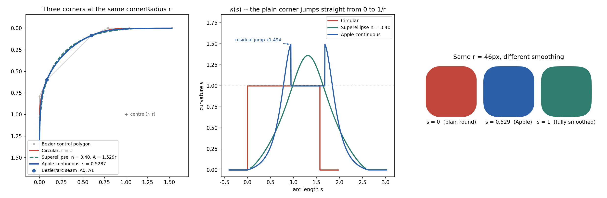
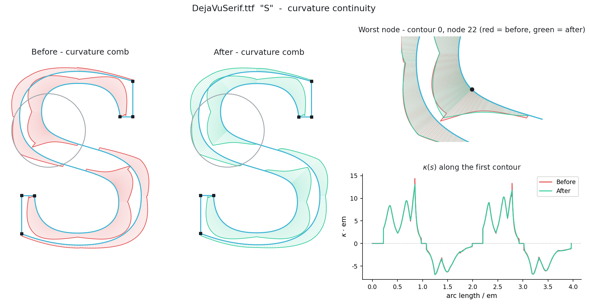
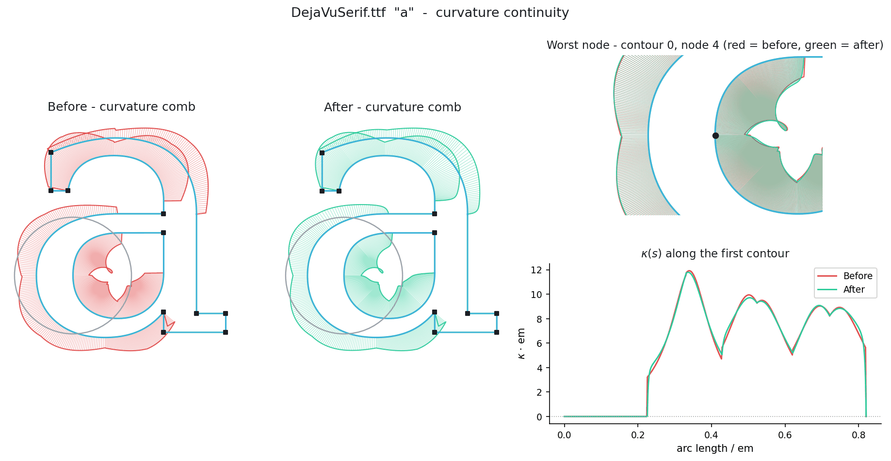

# continuous-curvature

Two small tools about the same idea: **where curvature jumps, and what it costs to remove the jump.**

| | |
|---|---|
| [`squircle.py`](squircle.py) | Reproduces Apple's "continuous corner" from closed form, and shows that it is G1, not G2 |
| [`curvcont.py`](curvcont.py) | Extracts a glyph from a `.ttf` / `.otf`, draws its curvature comb, and solves the outline to G2 |
| [`index.html`](index.html) | An interactive workbench for Part 1 — **[open the live demo](https://shentonyan.github.io/continuous-curvature/)** |

Both scripts are dependency-light, single-file, and print numbers you can check.

---

## Part 1 — Apple's continuous corner

`RoundedRectangle(cornerRadius:style:.continuous)` is widely described as a superellipse.
It is not. It is three pieces spliced together:

```
cubic Bézier  →  circular arc  →  cubic Bézier
```

### Closed form

Given a corner radius `r` and a smoothing factor `s ∈ [0, 1]`, let `β = 45° · s`:

```
p = (1 + s) · r                                  edge length the corner consumes
ℓ = r (cos β − sin β)                            arc span in x and in y
d = r (1 − cos β)                                lateral offset of the Bézier endpoint
c = r · tan(β/2) · cos β                         tangent handle for the arc endpoint
b = [ r (s + sin β) − r · tan(β/2) · cos β ] / 3
a = 2b
```

The arc sweeps `90°(1 − s)`. Apple measures `p = 1.528665 r`, i.e. **`s = 0.528665`**.
The "60%" preset in Figma's UI is an approximation of that value.



*Left:* the three corners at the same `r`, with the Bézier control polygon and the seams `A₀`, `A₁`.
*Middle:* κ along the arc length — the plain corner's vertical jump at the seam, against the
continuous corner's ramp (and its residual ×1.494 step). *Right:* how the same radius reads at
`s = 0`, Apple's `s = 0.5287`, and fully smoothed `s = 1`.

### Three identities the code verifies numerically

1. **Exact symmetry.** `(a + b + c) + ℓ + d ≡ p` — residual `2·10⁻¹⁶`.

2. **The arc is just the inscribed circle.** Centre `(r, r)`, radius `r` — the same circle a
   plain rounded corner uses. Smoothing only trims its ends and replaces them with Béziers.
   The seam therefore has a clean closed form:

   ```
   A₀ = ( r(1 − cos β),  r(1 − sin β) )
   ```

   which is proved in one line: `ℓ + d = r(cos β − sin β) + r(1 − cos β) = r(1 − sin β)`,
   so `(d − r)² + (ℓ + d − r)² = r² cos²β + r² sin²β = r²`.

3. **Curvature at the Bézier end.**

   ```
   κ_end · r = 4 cos³(β/2) · [ s + sin β − tan(β/2) cos β ] / ( 9 sin(β/2) )
   ```

### The finding: it is G1, not G2

For `0 < s < 1`, the expression is **greater than 1**. At Apple's `s = 0.5287`,
`κ_end` is about **1.4936** times the arc curvature. The ratio decreases to about `1.2952`
as `s → 1⁻`, and tends to the finite limit `(32/π + 4)/9 ≈ 1.5762` as `s → 0⁺`.
To see this, use `sin β − tan(β/2) cos β = tan(β/2)` and `β = πs/4` to rewrite
it as `(4/9) cos²(β/2) · [1 + s cot(β/2)]`. At `s = 0` the Bézier segment
collapses, so there is no Bézier/arc seam to compare.

So "continuous curvature" is a marketing term, not a geometric claim. What the construction
genuinely achieves is worth more than the name suggests: it moves the discontinuity **off the
straight edge and into the interior of the curve**, where a plain corner would jump `0 → 1/r`.

### The superellipse that fits best is not n = 4

Fixing the semi-axis at `A = p = 1.5287 r` and fitting only the exponent:

```
n = 3.399,   rms residual = 0.0073 r   (0.48% of p)
```

CSS's `corner-shape` takes `log2(exponent)`, so the closest CSS equivalent is:

```css
.apple-ish {
  border-radius: 1.5287 * r;
  corner-shape: superellipse(1.765);   /* exponent 3.399 */
}
```

`corner-shape: squircle` is shorthand for `superellipse(2)`, i.e. exponent **4** — noticeably
squarer than Apple's actual corner. (As of mid-2026 `corner-shape` is Chromium-only.)

### Usage

```bash
python3 squircle.py
```

Prints the full parameter report and writes `squircle_comparison.png` (outline overlay,
κ(s) plot, and the same radius at three smoothing values).

```python
from squircle import svg_path, corner_params, curvature_ratio, APPLE_SMOOTHING

svg_path(200, 200, 48)                 # full rounded-rect SVG path at Apple smoothing
corner_params(48, APPLE_SMOOTHING)     # every derived quantity
curvature_ratio(0.6)                   # → 1.4704
```

Or just open the **[live workbench](https://shentonyan.github.io/continuous-curvature/)**
(`index.html`, no build step, no dependencies): drag `r` and `s`, watch the curvature comb and the
superellipse fit update, and copy the generated SVG path, CSS, SwiftUI or JS straight out.

On Apple platforms you do not need any of this — `style: .continuous` is built in. The value
here is for the web, Canvas, and anywhere you want smoothing as a free parameter.

---

## Part 2 — Curvature continuity for vector outlines

Inspired by the tool Patch Kessler built for LoveFrom: analyse a vector outline and make it
curvature-continuous at any scale.

### The maths

A cubic Bézier `P0 P1 P2 P3` has a closed form for signed curvature at both ends — no numerical
differentiation needed:

```
κ(0) = (2/3) · (P1−P0) × (P2−P1) / |P1−P0|³
κ(1) = (2/3) · (P2−P1) × (P3−P2) / |P3−P2|³
```

At a node that is already G1 the two sides share one tangent direction `û`, and this collapses to

```
κ = (2/3) · h / ℓ²
```

where `h` is the perpendicular distance from the control point to the tangent line and `ℓ` is the
handle length. Therefore

```
G2  ⟺  h_in / ℓ_in²  =  h_out / ℓ_out²
```

That is the exact statement of what type designers call *balancing the handles*.

### The solve

Keep every tangent direction fixed, so G1 holds by construction. Free only:

- the two handle lengths `ℓ` of each curve segment
- a normal offset `δ` at each smooth node (nodes touching a line segment stay frozen — moving
  them would break G1)

Residuals, all normalised by em:

```
per smooth node:   κ_in − κ_out                             (the G2 condition)
                   ½(κ_in + κ_out) − κ_original             (curvature-profile anchor)
per unknown:       how far it moved from its original value (regularisation)
```

Solved with `scipy.optimize.least_squares`.





Red is the original, green is the solved outline. The comb makes the defect visible: the original
envelope has steps and kinks at the nodes, the solved one runs smooth. Black squares mark the
corners the tool detected and deliberately left alone. In the κ(s) panel the two curves sit almost
on top of each other — that is the curvature anchor doing its job, removing the jumps without
rewriting the designer's curvature profile.

### Results — DejaVu Serif, default settings

| glyph | nodes | corners kept | smooth nodes | max κ jump before | after | ratio | max outline deviation |
|---|---|---|---|---|---|---|---|
| `S` | 29 | 6 | 23 | 2.968 | 0.0247 | 120× | 0.183 % em |
| `a` | 30 | 10 | 20 | 5.555 | 0.0856 | 65× | 0.173 % em |
| `e` | 19 | 6 | 13 | 1.794 | 0.0289 | 62× | 0.189 % em |

κ is reported as `κ · em`; deviation is max one-sided Hausdorff distance, as a percentage of em.

**0.18 % em ≈ 3.7 / 2048 units.** At 16 px body text that is 0.03 px — invisible. On a 200 px
headline or a logo it is 0.4 px — which is exactly why this only pays off at display sizes, and
exactly why a display face like LoveFrom Serif is where someone bothers.

Corners (tangent angle > `--corner-deg`, default 15°) are detected and **left alone**. Making an
outline curvature-continuous should not round off a serif's corners.

### Two things worth knowing if you build something similar

**Do not let the solver move the nodes.** With node offsets weighted like handle lengths, the
solver discovers that sliding nodes is cheaper than rebalancing handles, and pushes the outline
**1.0 % em** off. Penalising node offsets 40× harder (`--node-reg`) freezes them almost
completely, drops deviation to **0.25 % em** — and still kills the κ jump. Handle lengths alone
were enough; they only stretch by a factor of 0.93–1.11.

**G2 alone is the wrong objective.** Minimising jumps and nothing else buys continuity with
wildly oscillating curvature — the fixed `a` had a *worse*-looking κ profile than the original.
The `--anchor` term pulls each node's mean curvature back to its original value, which makes the
goal what it should have been all along: *remove the jumps, keep the designer's curvature profile.*

### Usage

```bash
python3 curvcont.py --font /path/to/Font.ttf --char S --out out/
```

Writes per glyph: `S_before.svg`, `S_after.svg`, `S_report.json` (with a per-node jump table),
and `S_curvature.png` — before/after curvature combs, a magnifier on the worst node, and κ(s).

| flag | default | meaning |
|---|---|---|
| `--corner-deg` | 15 | tangent angles above this are real corners, left untouched |
| `--reg` | 0.04 | regularisation; higher is more conservative |
| `--node-reg` | 40 | extra penalty on node offsets; higher = solve with handles alone |
| `--anchor` | 0.25 | curvature-profile anchor; higher keeps the original κ shape |

### Known limitation

A curve/line node requires `κ = 0` on the curve side. Handle length alone can usually push the
residual to ~10⁻³ (× em), but at the cost of visibly stretched handles; those nodes are counted
separately in the report. The principled fix is to insert a curvature ramp at the seam — which is
precisely the construction in Part 1. The two halves of this repo are the same problem.

---

## The workbench

[`index.html`](index.html) is a single self-contained page — the only external request is the
Google Fonts stylesheet. It runs from a `file://` URL just as happily as from a server, and it is
what GitHub Pages serves at
**https://shentonyan.github.io/continuous-curvature/**
(Settings → Pages → Deploy from a branch → `main` / root).

It recomputes everything in the browser from the same closed form as `squircle.py`, including the
golden-section search for the best-fit superellipse exponent.

## Install

```bash
pip install -r requirements.txt
```

`numpy` is the only hard requirement; `scipy` is needed for the fits and the G2 solve,
`matplotlib` for figures, and `fonttools` for glyph extraction.

## References

- Daniel Furse, *Desperately seeking squircles* (Figma, 2018) — the smoothing parameterisation
- [My Quest for the Apple Icon Shape](https://liamrosenfeld.com/posts/apple_icon_quest/) — where `1.528665` comes from
- [Corner Smoothing on the Web](https://roomzer.dev/corner-smoothing-on-the-web/)
- [Squircles in CSS](https://squircle.js.org/blog/squircles-in-css) — `corner-shape` support

## License

MIT
